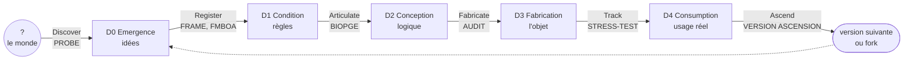

<p align="right">
  <a href="README.md"></a>
</p>

<h1 align="center">DRAFT</h1>

<p align="center">
  <b>D</b>iscover - <b>R</b>egister - <b>A</b>rticulate - <b>F</b>abricate - <b>T</b>rack<br>
  <i>une méthode pour penser, spécifier, construire et apprendre de n'importe quel Système</i>
</p>
<p align="center">
  <a href="CHANGELOG.md"></a>
  <a href="skills/draft/SKILL.md"></a>
  <a href="LICENSE"></a>
  <a href="LICENSE"></a>
</p>

## En une minute

**À quoi ça sert.** DRAFT range tout ce que vous savez d'un Système - une application,
une entreprise, un cours, un contrat, un mod de jeu - dans cinq vues séparées, pour que
chaque idée, règle, décision de conception, étape de construction et retour d'usager ait
exactement une place, et que chaque erreur puisse être remontée jusqu'à l'endroit où elle
coûtait le moins cher à corriger.

**Voyez-le comme** le jeu de plans d'un architecte : le programme, la réglementation, les
plans, le chantier et les plaintes des habitants sont tenus à part, et pourtant une
fissure dans un mur peut toujours être remontée jusqu'au plan qui l'a causée.

**Où la comparaison s'arrête.** Des plans se dessinent une fois, avant de construire.
DRAFT tourne en boucle : ce que rapportent les usagers devient la matière première de la
version suivante.

**Pour qui.** Un humain seul, un humain avec des assistants IA, ou une équipe. DRAFT est
une méthode, pas un programme : vous la lisez, ou vous la donnez à votre IA sous forme de
skills.

## Le schéma

Cinq vues du Système (D0 à D4), reliées par des outils. Chaque outil fait passer la
connaissance d'une vue à la suivante. Chaque verbe du nom est le pas qui fait entrer
dans une vue.



| Vue | Nom | Contient | Coût d'un changement ici |
|---|---|---|---|
| **D0** | Emergence | idées, sources, questions ouvertes | nul |
| **D1** | Condition | les règles, numérotées et sourcées : la source de vérité unique | minimal |
| **D2** | Conception | la logique : un contrat par unité, écrit avant de la construire | modéré |
| **D3** | Fabrication | l'objet lui-même : code, document, processus, objet physique | élevé |
| **D4** | Consumption | ce que l'usage réel rapporte | extrême : le défaut a déjà atteint quelqu'un |

Les numéros classent le **coût**, pas l'ordre : commencez là où se trouve votre matière.
Corriger un problème, c'est revenir à la vue la moins chère qui l'explique, et revenir en
arrière n'est jamais un échec.

## Les outils

Un outil DRAFT est remplaçable : il fait une étape, et un autre outil pourrait la faire à
sa place. Les outils par défaut :

| Étape | Outil | Ce qu'il fait |
|---|---|---|
| Discover : monde -> D0 | **PROBE** | mesure un fait non vérifié (une API, un matériau, une règle) avant de concevoir dessus |
| Register : D0 -> D1 | **FRAME** | écrit à quoi sert le Système et sa silhouette, avant toute règle |
| Register : D0 -> D1 | **FMBOA** | range chaque exigence en Formats, Mandatory, Beyond, Open points, Ambiguities |
| Articulate : D1 -> D2 | **BIOPGE** | un contrat par unité : Boundary, Inputs, Outputs, Process, Guaranty, Errors |
| Articulate : D1 -> D2 | GRAIN schema | carte facultative des grands blocs du Système, avant les contrats |
| Fabricate : D2 -> D3 | SIMULATE | exécution à blanc facultative des contrats, pour trouver les contradictions avant de construire |
| Fabricate : D2 -> D3 | **AUDIT** | vérifie l'objet construit contre ses contrats |
| Track : D3 -> D4 | **STRESS-TEST** | confronte l'objet à un usage réel simulé, avant que de vrais usagers ne le fassent |
| Ascend : D4 -> suivante | **VERSION ASCENSION** | compare ce que les usagers ont fait avec ce à quoi le Système devait servir |

### Le zoom : GRAIN

Chaque connaissance se situe aussi à un niveau de détail, de G0 (une analogie) à G6 (une
exécution mesurée). DRAFT se lit à travers cette échelle, appelée GRAIN :

| G0 | G1 | G2 | G3 | G4 | G5 | G6 |
|---|---|---|---|---|---|---|
| Analogie | Silhouette | Topologie | Exigence | Contrat | Substrat | Exécution |
| à quoi ça sert | qui l'utilise, ce qui entre et sort | les grands blocs | ce qui doit tenir | ce que chaque unité garantit | l'objet lui-même | ce que montre une exécution |

Chaque vue a un niveau d'ancrage : les règles vivent en G3, les contrats en G4, l'objet
construit en G5 et G6. Une vue ne contient jamais rien de plus fin que son ancrage : pas
de code dans les règles, pas de code dans les contrats. La carte complète de quel outil
écrit à quel niveau se trouve dans
[`skills/draft/DRAFT_tools/CATALOGUE.md`](skills/draft/DRAFT_tools/CATALOGUE.md).

## L'utiliser

| Vous êtes | Faites ceci |
|---|---|
| **Un lecteur humain** | Lisez cette page, puis [`METHOD.md`](METHOD.md) (en anglais) |
| **Claude Code** | `/plugin marketplace add Sayca-Jferone/DRAFT`, puis `/plugin install draft@saycalabs-draft` |
| **claude.ai** | Téléchargez `draft.zip` et `grain.zip` depuis la [dernière release](https://github.com/Sayca-Jferone/DRAFT/releases/latest), téléversez chacun comme skill personnalisé dans vos paramètres |
| **Toute autre IA** | Téléchargez `DRAFT-<version>.md` depuis la [dernière release](https://github.com/Sayca-Jferone/DRAFT/releases/latest) et joignez-le à votre conversation |
| **Installation manuelle** | Clonez ce dépôt et copiez ou liez `skills/draft/` et `skills/grain/` dans le dossier de skills de votre agent |

Facultatif, pour le logiciel : le plugin `draft-instances` (ou `stress-gate.zip` et
`api-probe.zip`) apporte des versions propres au code de STRESS-TEST et PROBE.

Chaque version est archivée. Un projet écrit sous une version antérieure se lit avec
cette version : rien de ce que vous avez écrit n'expire. Les versions jusqu'à 0.73.1
sont aussi conservées dans [`AI-skills/`](AI-skills/).

### Quoi demander à votre IA

> "Démarre une Matrix DRAFT pour ce dépôt. Rassemble ce qui existe déjà dans D0 avant d'écrire la moindre règle."

> "Voici le PDF du sujet. Écris le FRAME, puis les exigences D1 : chaque ambiguïté nommée, rien de résolu en silence."

> "Audite `src/` contre les contrats D2 et dis-moi quels défauts sont formels et lesquels sont des erreurs de logique."

> "Un usager a signalé ce bug. À quelle vue appartient-il vraiment ?"

## À quoi ressemble le dossier DRAFT d'un projet

Un projet qui utilise DRAFT range ses vues dans un dossier `.draft/`, appelé sa Matrix :

```txt
.draft/
  PASSPORT.md                        identité : nom, version, licence, version de DRAFT
  STATE.md                           facultatif : où en est chaque vue (ou votre outil de suivi)
  PENDING.md                         facultatif : décidé mais pas fait, et questions ouvertes
  dimensions/
    D0-emergence/IDEATION.md
    D1-condition/SRS-FMBOA.md        le FRAME en tête, puis les règles F M B O A
    D2-conception/SLB-BIOPGE.md      un contrat par unité
    D3-fabrication/DEVJOURNAL.md
    D4-consumption/FEEDBACKS.md
```

Une règle D1 tient sur une ligne : un ID, un état, l'exigence, comment la vérifier, si
elle est construite et testée, et d'où elle vient :

| ID | STATE | ITEM | Verify | Dev | Test | Source |
|---|---|---|---|---|---|---|
| M1 | TODO | Le conteneur redémarre après un crash. | le tuer, le voir revenir | TODO | TODO | sujet p. 7 |

Un contrat D2 est un tableau par unité, écrit avant de construire l'unité :

| BIOPGE | Contenu |
|---|---|
| **B**oundary | `io.c` - possède la lecture disque et la validation JSON. PAS le parsing des arguments, PAS la logique métier |
| **I**nputs | `path: str`, fichier existant et lisible |
| **O**utputs | `list`, effet de bord : aucun |
| **P**rocess | 1. ouvrir le fd -> 2. parser le JSON -> 3. vérifier que le type externe est une liste -> 4. la renvoyer |
| **G**uaranty | fd toujours fermé ; sortie lisible par `json.loads` |
| **E**rrors | fichier absent -> `FileNotFoundError`, propagée ; l'appelant sort avec le code 1 |

Aucun compte ni pourcentage n'est stocké là où un lecteur peut le calculer : la Matrix
ne peut donc pas diverger d'elle-même. La Matrix est du Markdown simple : un humain ou
une IA la lit, aucun logiciel particulier n'est nécessaire.

## Ce qu'elle a réellement produit

Un cycle tracé, pas un benchmark : un Système, un auteur, pas de groupe témoin.

**Inception** (école 42, Docker / WordPress / MariaDB / NGINX), de D0 à D3, de juillet
à septembre 2026 :

| Vue | Résultat |
|---|---|
| D1 | 266 règles, 58 obligatoires, 27 clauses terminales avec l'observation qui révélerait chaque violation |
| D2 | 11 contrats dérivés de D1 sans aucune nouvelle question à l'auteur |
| D3 | 882 lignes, 6 défauts, tous formels, zéro erreur de logique |

Aucun contrat ne décrivait la mauvaise chose. Deux des six défauts passaient tous les
tests d'exécution et n'ont été trouvés qu'en auditant la construction contre ses
contrats. Le coût : six semaines de D1 avant la première ligne de substrat. Un Système
trop petit pour avoir un problème de spécification ne remboursera pas cet effort.

Détails, et ce qui n'est délibérément pas affirmé : [`METHOD.md`](METHOD.md), section
*What DRAFT actually produced*.

## Les règles qu'elle suit

- **Rien n'est construit avant que son contrat existe**, sauf une unité qui a au plus une interface.
- **Aucune ambiguïté n'est résolue en silence.** Elle se résout par une question, ou se marque `[ASSUMED]` avec une raison.
- **Une erreur de logique n'est jamais reclassée en erreur formelle** pour éviter une friction.
- **Tout changement déclenche une vérification de propagation** sur les quatre autres vues, jusqu'à la clôture de la version.
- **Aucune vue ne contient de détail plus fin que son ancrage** : pas de code dans les règles, pas de code dans les contrats.
- **Toute vue peut être transmise à un tiers**, humain ou IA, sans perte de contenu logique.
- **Outil neutre, usage non neutre.** DRAFT n'est jamais utilisé pour exploiter les failles d'un Système ni contourner
  ses protections. Voir [`METHOD.md`](METHOD.md), section *Ethics*.

## Cassez cette méthode

DRAFT est une méthode v0.x à auteur unique, et ses affirmations les plus fortes sont
les moins testées. La contribution la plus utile est un cas concret où elle échoue :

- un Système qui n'entre pas dans les cinq vues, ou seulement en le forçant ;
- un contrat impossible à écrire pour un composant réel ;
- un projet où la méthode a coûté plus qu'elle n'a rapporté ;
- une propagation qui boucle sans converger.

Ouvrez une issue avec le modèle **Destruction report**. Les règles de contribution sont
dans [`.github/`](.github/).

## Aller plus loin

| Fichier | Contenu |
|---|---|
| [`METHOD.md`](METHOD.md) | La méthode complète : définitions, discipline et critères de sortie de chaque vue, propagation, sous-systèmes |
| [`GLOSSARY.md`](GLOSSARY.md) | Chaque terme, une définition chacun |
| [`CHANGELOG.md`](CHANGELOG.md) | Ce qui a changé à chaque version, et pourquoi |
| [`skills/`](skills/) | La méthode sous forme de skills pour agents : `draft`, `grain`, et les versions logiciel |
| [`skills/draft/DRAFT_tools/`](skills/draft/DRAFT_tools/) | Chaque outil, ses règles et son catalogue |

Ces fichiers sont en anglais.

La version publique n'inclut pas la vue `Dε`, en amont de D0, ni son moteur WTNE
(Wished Theoretical Non-Existents simulation tables).

## Usage de l'IA

DRAFT porte sur la traçabilité : il déclare donc ses propres outils.

**Ce qui revient à l'auteur.** La méthode elle-même. DRAFT est la méthodologie de travail
de l'auteur, affinée et ouverte : la séquence par laquelle un Système est abordé,
spécifié et composé, telle qu'elle était pratiquée avant qu'un agent n'en écrive une
ligne. Cela couvre les définitions, les cinq vues, les outils, les formats, les règles
strictes et chaque décision de version. Les agents ont aidé à la mettre par écrit ; ils
ne l'ont pas conçue.

**Ce que font les agents IA.** Des modèles Claude d'Anthropic, via Claude Code et
claude.ai, travaillent comme outils sous la relecture de l'auteur :

- rédaction et restructuration de textes à partir de décisions déjà prises : changelog,
  glossaire, les skills de `skills/`, les fichiers de gouvernance de `.github/` ;
- passes de qualité sur la méthode elle-même, dont l'auteur accepte ou rejette les
  conclusions ;
- migrations de version d'une Matrix, vérifiées ensuite en comptant les entrées par
  catégorie ;
- audits de conformité d'une construction contre ses contrats D2 ;
- critique externe : une instance indépendante est chargée d'attaquer un brouillon, et
  ses objections entrent en D0 comme matière brute, jamais comme décisions.

**Comment c'est contrôlé.** Les agents sont tenus par les mêmes règles strictes que les
humains : aucune ambiguïté résolue en silence, aucune construction avant son contrat.
Rien de ce qu'un agent renvoie n'est enregistré avant relecture par l'auteur : sur une
délégation mesurée, six unités rendues avec des tests au vert contenaient encore six
défauts, dont aucun n'avait été signalé par l'agent lui-même.

**Attribution.** Chaque commit est signé par l'auteur. Cinq commits du 2026-09-26
portent une mention `Co-Authored-By: Claude`, antérieure à cette déclaration qui a
remplacé ces mentions ; ils sont conservés tels quels plutôt que de réécrire un
historique public. Une exécution faite par un agent sans relecture humaine serait
signée par cet agent.

## Licence

Auteur : Sayca Jason FERONE (`@sayca-jferone`), sous la signature **Sayca Labs**.

Code et skills : `Apache 2.0`. Documentation : `CC BY 4.0`.

Voir [`LICENSE`](LICENSE) et [`NOTICE`](NOTICE). Pour citer DRAFT : [`CITATION.cff`](CITATION.cff).

> SPDX-FileCopyrightText: 2026 Sayca Jason FERONE <legal@saycalabs.com>
>
> SPDX-License-Identifier: Apache-2.0
>
> DOCS-License-Identifier: CC BY 4.0
