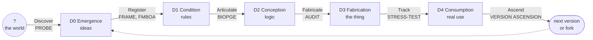

<p align="right">
  <a href="README.fr.md"></a>
</p>

<h1 align="center">⬠ DRAFT Framework</h1>

<p align="center">
  <b>D</b>iscover - <b>R</b>egister - <b>A</b>rticulate - <b>F</b>abricate - <b>T</b>rack
</p>

<h3 align="center">
  Every Thing that exists can be shown as a System<br>under the 5 Dimensions of the DRAFT Matrix.
</h3>

<p align="center">
  <i>For Humans & AIs to think, specify, build and learn from any System of any domain</i>
</p>

<p align="center">
  <a href="CHANGELOG.md"></a>
  <a href="skills/grain/SKILL.md"></a>
  <a href="skills/draft/SKILL.md"></a>
  <a href="LICENSE"></a>
  <a href="LICENSE"></a>
</p>

<p align="center">
  <a href="#the-framework"></a>
  <a href="#the-method"></a>
  <a href="#the-tools"></a>
  <a href="#evidence"></a>
  <a href="#use-it"></a>
</p>

> **News**
> - [YYYY/MM] **DRAFT v0.75.1**: <one line from CHANGELOG.md>
> - [2026/11] **GRAIN v1.2.0**: rulings validated, GRAIN is standalone and GER consumes it as its zoom steps.
> - Every release is archived: a Matrix written under an older version is read with that version. See [CHANGELOG.md](CHANGELOG.md).

<h2 align="center" id="overview">Overview</h2>

<p align="center">
  <i>
    Every System accumulates ideas, rules, design decisions, build steps and user feedback.<br>
    Mixed together, a mistake cannot be traced back to where it was cheapest to fix.<br>
    <br>
    <b>DRAFT</b> keeps them in <b>five separate views</b>, joined by <b>replaceable tools</b>,<br>
    read through <b>one zoom scale</b>. Every fact has exactly one place.
  </i>
</p>

<p align="center"><b>Better DRAFT than DRIFT.</b></p>

> [!NOTE]
> **Think of it as** an architect's set of plans: the brief, the regulations, the blueprints,
> the building site and the residents' complaints are kept apart, yet a crack in a wall can
> always be followed back to the plan that caused it.
> **Where the comparison stops**: plans are drawn once, before building. DRAFT runs in a
> loop: what users report becomes raw material for the next version.

<h2 align="center" id="highlights">Highlights</h2>

- 🧭 **Five views, one place per fact**: ideas, rules, logic, the built thing and real use never share a file.
- 💸 **Ranked by cost, not by order**: start wherever your material is; fixing means walking back to the cheapest view that explains the problem.
- 📜 **Contract before build**: nothing is built before its contract exists, except a unit with at most one interface.
- 🔍 **One zoom scale (GRAIN)**: every piece of knowledge sits at a level of detail from G0 (an analogy) to G6 (a measured run).
- 🔁 **Propagation**: any change triggers a check across the four other views, until the version is closed.
- 🌐 **Domain-agnostic**: an app, a company, a course, a contract, a game mod.
- 📄 **Plain Markdown**: a human or an AI reads it, no special software needed.
- 🤝 **Handoff-ready**: any view can be handed to a third party, human or AI, without loss of logical content.

<h2 align="center" id="the-framework">The framework</h2>

DRAFT is a method, not a program: you read it, or you give it to your AI as skills.
The framework is made of:

| Component | What it is | Where | Status |
|---|---|---|---|
| **D.R.A.F.T method** | five views D0 to D4, the transitions between them, the hard rules, propagation | [`METHOD.md`](METHOD.md), [`skills/draft/`](skills/draft/) | public |
| **DRAFT Tools** | replaceable instruments, each carrying one transition | [`skills/draft/DRAFT_tools/`](skills/draft/DRAFT_tools/) | public |
| **GRAIN** | the description grain scale G0 to G6 of one System | [`skills/grain/`](skills/grain/) | public |
| **GER** | Granular Epistemic Resolution: adjusts the resolution of one chosen idea, in any view, without levelling the rest; uses GRAIN as its zoom steps | not published | in design |
| **Software instances** | code-specific versions of PROBE and STRESS-TEST | `draft-instances` plugin | public |
| **Dε and WTNE** | a view upstream of D0, and its simulation engine | not published | private |

<h2 align="center" id="the-method">The method</h2>

Five views of the System (D0 to D4), joined by tools. Each tool moves knowledge
from one view to the next. Each verb of the name is the step into a view.



| View | Name | Holds | Cost of a change here |
|---|---|---|---|
| **D0** | Emergence | ideas, sources, open questions | none |
| **D1** | Condition | the rules, numbered and sourced: the single source of truth | minimal |
| **D2** | Conception | the logic: one contract per unit, written before it is built | moderate |
| **D3** | Fabrication | the thing itself: code, document, process, object | high |
| **D4** | Consumption | what real use reports back | extreme: it already reached someone |

> [!TIP]
> The numbers rank **cost**, not order. Going back to a cheaper view is never a failure.

<h2 align="center" id="the-tools">The tools</h2>

A DRAFT tool is replaceable: it does one step, and another tool could do it instead.
The default ones:

| Step | Tool | What it does |
|---|---|---|
| Discover: world -> D0 | **PROBE** | measures an unverified fact (an API, a material, a rule) before you design on it |
| Register: D0 -> D1 | **FRAME** | writes what the System is for and its outline, before any rule |
| Register: D0 -> D1 | **FMBOA** | sorts every requirement into Formats, Mandatory, Beyond, Open points, Ambiguities |
| Articulate: D1 -> D2 | **BIOPGE** | one contract per unit: Boundary, Inputs, Outputs, Process, Guaranty, Errors |
| Articulate: D1 -> D2 | GRAIN schema | optional map of the System's large blocks, before contracts |
| Fabricate: D2 -> D3 | SIMULATE | optional dry run of the contracts, to find contradictions before building |
| Fabricate: D2 -> D3 | **AUDIT** | checks the built thing against its contracts |
| Track: D3 -> D4 | **STRESS-TEST** | confronts the thing with simulated real use before real users do |
| Ascend: D4 -> next | **VERSION ASCENSION** | compares what users did with what the System was for |

<h3 align="center" id="the-zoom">The zoom: GRAIN</h3>

| G0 | G1 | G2 | G3 | G4 | G5 | G6 |
|---|---|---|---|---|---|---|
| Analogy | Silhouette | Topology | Requirement | Contract | Substrate | Execution |
| what it is for | who uses it, what goes in and out | the large blocks | what must hold | what each unit guarantees | the thing itself | what a run shows |

Each view has a home level: rules live at G3, contracts at G4, the built thing at G5
and G6. The full map of which tool writes at which level is in
[`CATALOGUE.md`](skills/draft/DRAFT_tools/CATALOGUE.md).

### Why GRAIN?

> **Without a grain axis**: one document mixes the analogy, the rule and the code. A reader
> cannot tell which sentence has authority, and a summary passes for a specification.
>
> **With GRAIN**: one grain per paragraph. Each level stands on its own, authority rises as
> grain descends, so a conflict between two levels is settled by the finer one, and a
> measured run (G6) is the floor of truth.

> [!IMPORTANT]
> A view never holds anything finer than its home level: no code inside the rules,
> no code inside the contracts.

<h2 align="center" id="examples">Examples</h2>

<table>
<tr>
<td width="50%" valign="top">
<b>01 · Start a Matrix</b>
<br><sub>"Start a DRAFT Matrix for this repository. Collect what already exists into D0 before writing any rule."</sub>
<br><sub><b>Lands in</b>: D0</sub>
</td>
<td width="50%" valign="top">
<b>02 · Specify from a subject</b>
<br><sub>"Here is the subject PDF. Write the FRAME, then the D1 requirements: every ambiguity named, nothing resolved silently."</sub>
<br><sub><b>Tools</b>: FRAME, FMBOA</sub>
</td>
</tr>
<tr>
<td width="50%" valign="top">
<b>03 · Audit a build</b>
<br><sub>"Audit <code>src/</code> against the D2 contracts and tell me which defects are formal and which are logic errors."</sub>
<br><sub><b>Tool</b>: AUDIT</sub>
</td>
<td width="50%" valign="top">
<b>04 · Route a bug</b>
<br><sub>"A user reported this bug. Which view does it really belong to?"</sub>
<br><sub><b>From</b>: D4, walking back to the cheapest view</sub>
</td>
</tr>
</table>

<h2 align="center" id="evidence">Evidence</h2>

One traced cycle, not a benchmark: one System, one author, no control group.

**Inception** (42 school, Docker / WordPress / MariaDB / NGINX), D0 to D3, July to September 2026:

| View | Outcome |
|---|---|
| D1 | 266 rules, 58 mandatory, 27 terminal clauses with the observation that would expose each violation |
| D2 | 11 contracts derived from D1 with zero new questions to the author |
| D3 | 882 lines, 6 defects, all formal, zero logic errors |

**Key findings**
- **No contract described the wrong thing**: every defect was formal, none was a logic error.
- **The audit caught what tests missed**: two of the six defects passed every runtime test.
- **D1 was enough to write D2**: eleven contracts, zero questions back to the author.

> [!WARNING]
> **The cost**: six weeks of D1 before the first line of substrate. A System too small
> to have a specification problem will not repay that.

Details and what is deliberately not claimed: [`METHOD.md`](METHOD.md), section *What DRAFT actually produced*.

<h2 align="center" id="use-it">Use it</h2>

<details open>
<summary><b>Install</b></summary>

| You are | Do this |
|---|---|
| **A human reader** | Read this page, then [`METHOD.md`](METHOD.md) |
| **Claude Code** | `/plugin marketplace add Sayca-Jferone/DRAFT`, then `/plugin install draft@saycalabs-draft` |
| **claude.ai** | Download `draft.zip` and `grain.zip` from the [latest release](https://github.com/Sayca-Jferone/DRAFT/releases/latest), upload each as a custom skill in your settings |
| **Any other AI** | Download `DRAFT-<version>.md` from the [latest release](https://github.com/Sayca-Jferone/DRAFT/releases/latest) and attach it to your conversation |
| **Manual install** | Clone this repository and copy or link `skills/draft/` and `skills/grain/` into your agent's skills folder |

Optional, for software work: the `draft-instances` plugin (or `stress-gate.zip` and
`api-probe.zip`) gives code-specific versions of STRESS-TEST and PROBE.

Versions up to 0.73.1 are also kept in [`AI-skills/`](AI-skills/).

</details>

<details>
<summary><b>What a project's <code>.draft/</code> folder looks like</b></summary>

A project using DRAFT keeps its views in a `.draft/` folder, called its Matrix:

```txt
.draft/
  PASSPORT.md          identity: name, version, license, DRAFT version
  STATE.md             optional: where each view stands (or use your issue tracker)
  PENDING.md           optional: decided-not-done, and open questions
  D0_IDEATION.md       raw material, unfiltered
  D1_SRS-FMBOA.md      FRAME at the head, then F M B O A rules
  D2_SLB-BIOPGE.md     one contract per unit
  D3_DEVJOURNAL.md     build journal
  D4_FEEDBACKS.md      what real use reports back
  sources/             what the System is built from: subject, brief, standard
```

No count or percentage is stored where a reader can compute it, so the Matrix cannot
drift from itself.

</details>

<details>
<summary><b>A D1 rule and a D2 contract</b></summary>

A D1 rule is one row: an ID, a state, the requirement, how to verify it, whether it
is built and tested, and where it came from:

| ID | STATE | ITEM | Verify | Dev | Test | Source |
|---|---|---|---|---|---|---|
| M1 | TODO | The container restarts on crash. | kill it, watch it return | TODO | TODO | subject p. 7 |

A D2 contract is one table per unit, written before the unit is built:

| BIOPGE | Content |
|---|---|
| **B**oundary | `io.c` - owns disk reads and JSON validation. NOT argument parsing, NOT business logic |
| **I**nputs | `path: str`, existing readable file |
| **O**utputs | `list`, side effect: none |
| **P**rocess | 1. open fd -> 2. parse JSON -> 3. check outer type is a list -> 4. return it |
| **G**uaranty | fd always closed; output parseable by `json.loads` |
| **E**rrors | missing file -> `FileNotFoundError`, propagated; caller exits 1 |

</details>

<h2 align="center" id="rules-it-follows">Rules it follows</h2>

- **Nothing is built before its contract exists**, except a unit with at most one interface.
- **No ambiguity is resolved silently.** It is resolved by a question, or marked `[ASSUMED]` with a reason.
- **A logic error is never reclassified as formal** to avoid friction.
- **Any change triggers a propagation check** across the four other views, until the version is closed.
- **No view holds detail finer than its home level**: no code in the rules, no code in the contracts.
- **Any view can be handed to a third party**, human or AI, without loss of logical content.

> [!CAUTION]
> **Neutral tool, not neutral use.** DRAFT is never used to exploit a System's flaws
> or bypass its safeguards. See [`METHOD.md`](METHOD.md), section *Ethics*.

<h2 align="center" id="break-this-method">Break this method</h2>

DRAFT is a single-author v0.x method, and its strongest claims are its least tested.
The most useful contribution is a concrete case where it fails:

- [ ] a System that does not fit the five views, or fits only by forcing it
- [ ] a contract that cannot be written for a real component
- [ ] a project where the method cost more than it saved
- [ ] a propagation that loops without converging

Open an issue with the **Destruction report** template. Contribution rules are in [`.github/`](.github/).

<h2 align="center" id="go-deeper">Go deeper</h2>

| File | Holds |
|---|---|
| [`METHOD.md`](METHOD.md) | The full method: definitions, every view's discipline and exit gates, propagation, sub-systems |
| [`GLOSSARY.md`](GLOSSARY.md) | Every term, one definition each |
| [`CHANGELOG.md`](CHANGELOG.md) | What changed per version, and why |
| [`skills/`](skills/) | The framework as agent skills: `draft`, `grain`, and the software instances |
| [`skills/draft/DRAFT_tools/`](skills/draft/DRAFT_tools/) | Every tool, its rules and its catalogue |

<h2 align="center" id="ai-usage">AI usage</h2>

DRAFT is about traceability, so it declares its own tools.

**What is the author's.** The method itself. DRAFT is the author's own working
methodology, refined and opened: the sequence by which a System is approached,
specified and composed, as practised before any agent wrote a line of it. That covers
the definitions, the five views, the tools, the formats, the hard rules and every
version decision. Agents helped write it down; they did not originate it.

**What AI agents do.** Anthropic Claude models, through Claude Code and claude.ai,
work as tools under the author's review:

- drafting and restructuring text from decisions already made: changelog, glossary,
  the skills in `skills/`, governance files in `.github/`;
- quality passes over the method itself, whose findings the author accepts or rejects;
- version migrations of a Matrix, verified afterwards by counting entries per category;
- conformity audits of a build against its D2 contracts;
- external critique: an independent instance is asked to attack a draft, and its
  objections enter D0 as raw material, never as decisions.

**How it is controlled.** Agents are bound by the same hard rules as humans: no
silent resolution of an ambiguity, no build before its contract. Nothing an agent
returns is recorded before the author has reviewed it: on a measured delegation, six
units returned with passing tests still held six defects, none flagged by the agent
itself.

**Attribution.** Every commit is authored by the author. Five commits of 2026-09-26
carry a `Co-Authored-By: Claude` trailer, from before this declaration replaced
trailers; they are kept as they are rather than rewriting public history. A run made
by an agent with no human review would be signed by that agent.

<h2 align="center" id="citation">Citation</h2>

If DRAFT is useful to your work, cite it with [`CITATION.cff`](CITATION.cff), or:

```bibtex
@software{ferone2026draft,
  title   = {DRAFT Framework: Discover, Register, Articulate, Fabricate, Track},
  author  = {FERONE, Sayca Jason},
  year    = {2026},
  version = {0.75.1},
  url     = {https://github.com/Sayca-Jferone/DRAFT}
}
```

<h2 align="center" id="license">License</h2>

Author: Sayca Jason FERONE (`@sayca-jferone`) under **Sayca Labs** signature.

Code and skills: `Apache 2.0`. Docs: `CC BY 4.0`.
See [`LICENSE`](LICENSE) and [`NOTICE`](NOTICE).

> SPDX-FileCopyrightText: 2026 Sayca Jason FERONE <legal@saycalabs.com>
>
> SPDX-License-Identifier: Apache-2.0
>
> DOCS-License-Identifier: CC BY 4.0